<div align="center">

# ✚ University Medical Center

**A web-based management system for a university medical center, covering patient registration, daily token queue, doctor consultation, pharmacy dispensing, administration and an AI help assistant.**


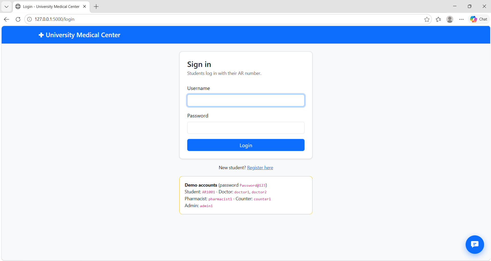

</div>

---

## ✨ Features

| Role | What they can do |
|------|------------------|
| 🎓 **Student (Patient)** | Register, log in with their AR number, take a daily token, view their own prescription history |
| 🧾 **Counter Officer** | Register walk-in patients, issue tokens, monitor today's queue |
| 🩺 **Doctor** | See the live queue, start a consultation, review patient history, prescribe medicines, set availability |
| 💊 **Pharmacist** | See pending prescriptions, dispense medicines, monitor stock (green / red indicator) |
| 🛠️ **Admin** | Manage users, doctors, medicines and stock, fix patient details, view reports and an audit log |
| 🤖 **AI Assistant** | A chat widget on every page that answers questions about the center (powered by Google Gemini) |

### Highlights
- **Safe token numbering**: tokens are issued inside a MySQL stored procedure with a lock, so two patients can never get the same number.
- **Stock protection**: prescribing deducts stock in the same transaction, so stock can never go below zero.
- **Role-based access control** on every route, plus **CSRF protection** on every form.
- **Hashed passwords** (PBKDF2-SHA256), never stored in plain text.
- **Audit log**: every admin change is recorded (passwords are never logged).
- **Privacy by design**: the Admin cannot see diagnoses or prescriptions.

---

## 📸 Screenshots

### Student
| Dashboard | Prescription history |
|:--:|:--:|
| 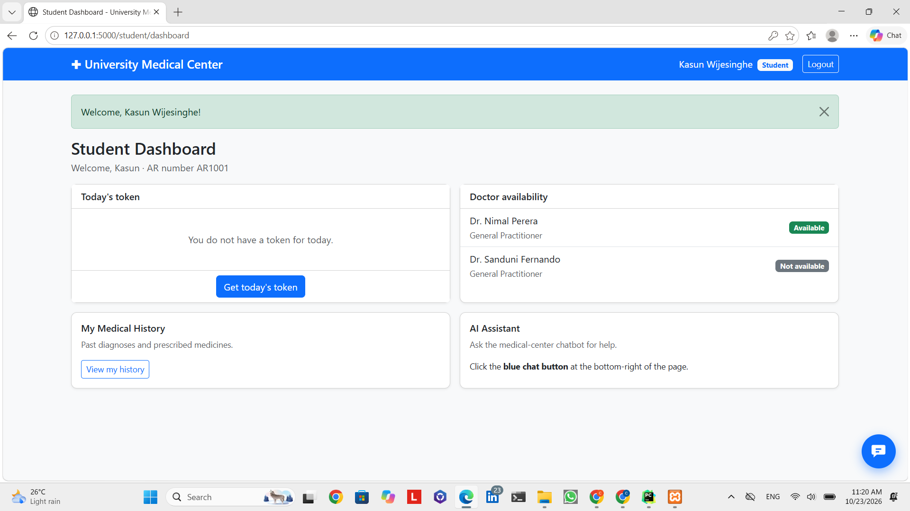 | 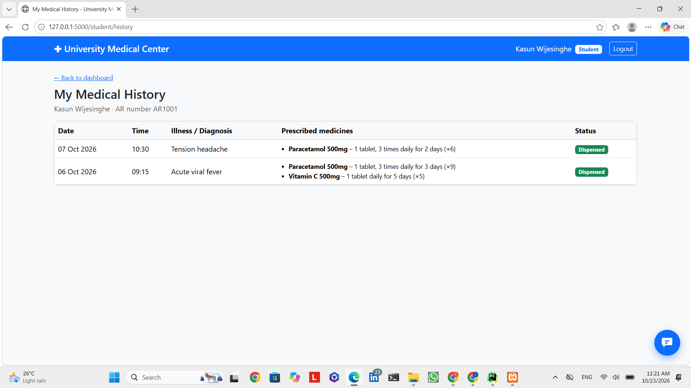 |

### Counter, Doctor and Pharmacy
| Counter | Doctor consultation | Pharmacy |
|:--:|:--:|:--:|
| 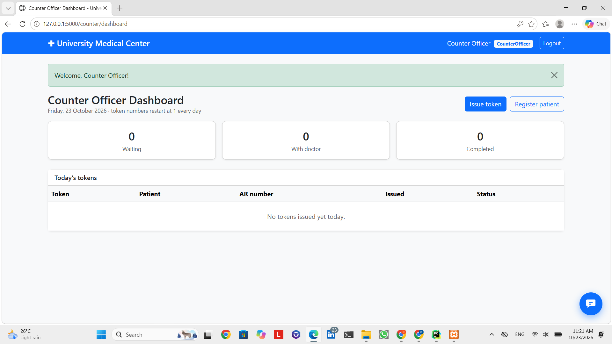 | 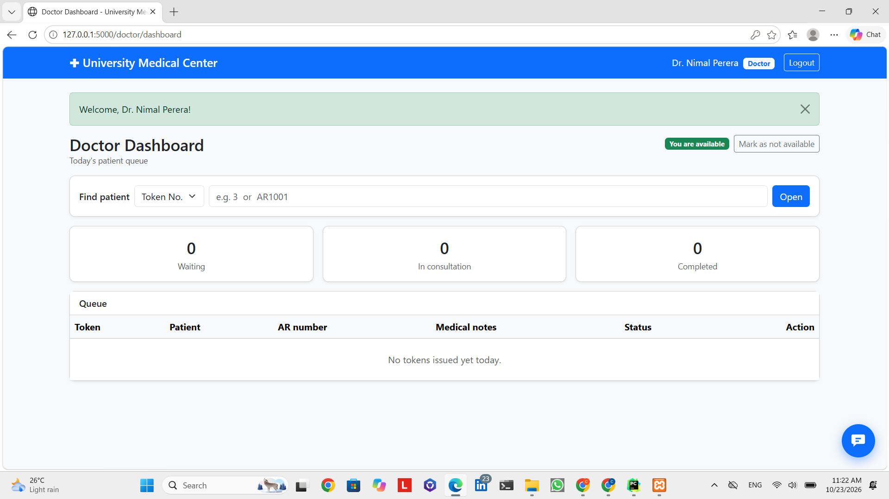 | 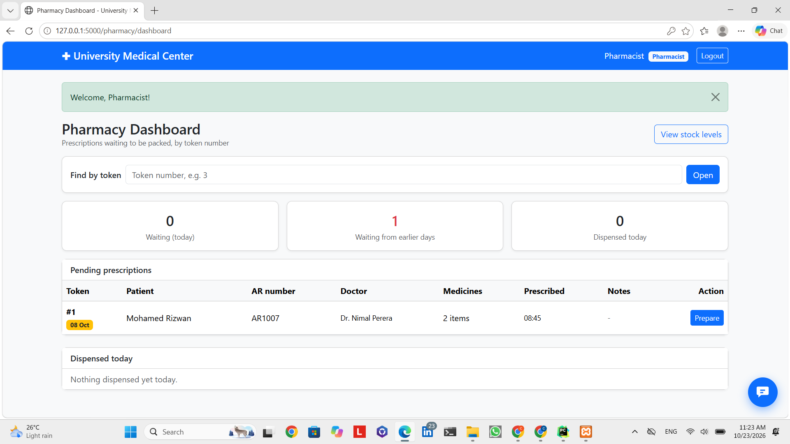 |

### Admin
| Overview | Medicines and stock |
|:--:|:--:|
| 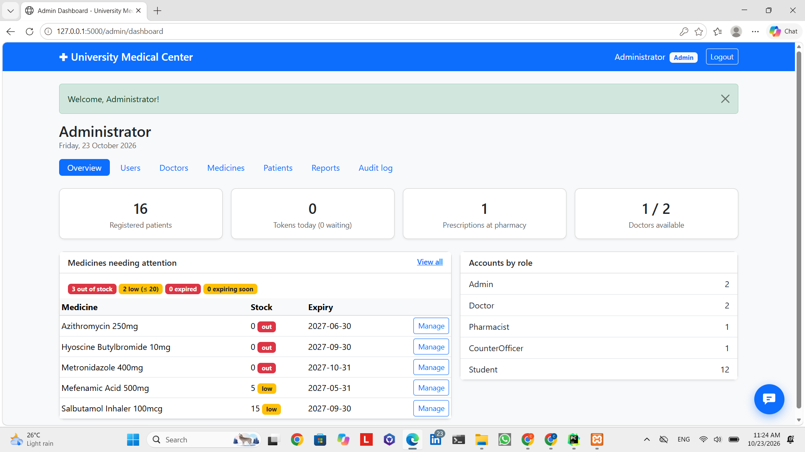 | 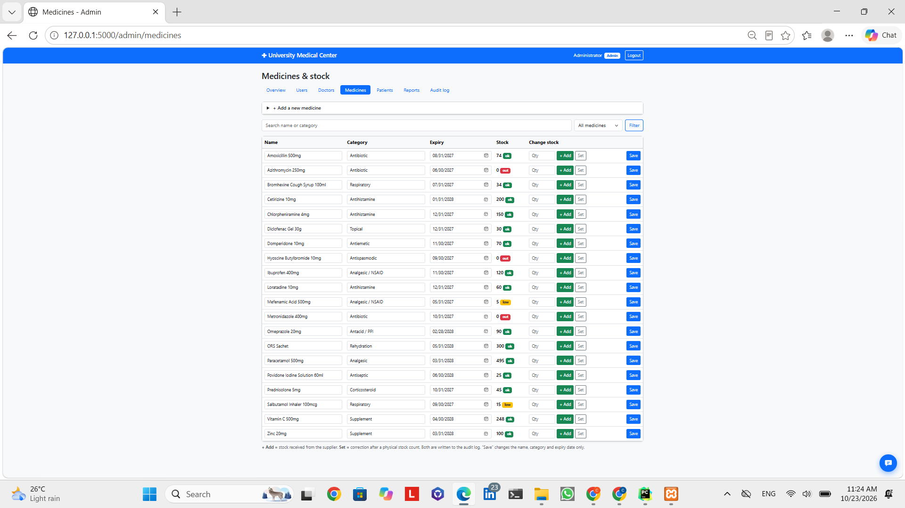 |

| Users | Reports |
|:--:|:--:|
| 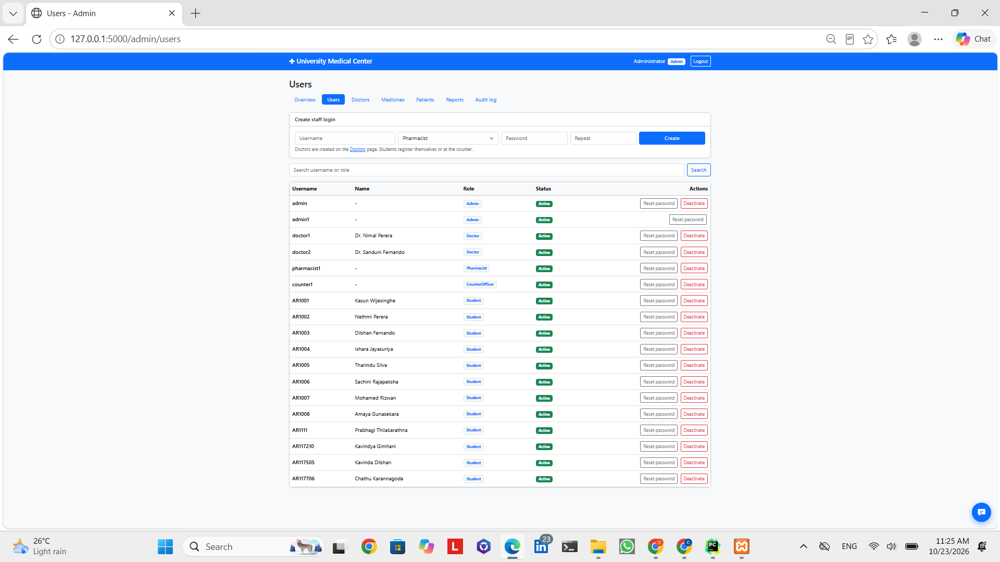 | 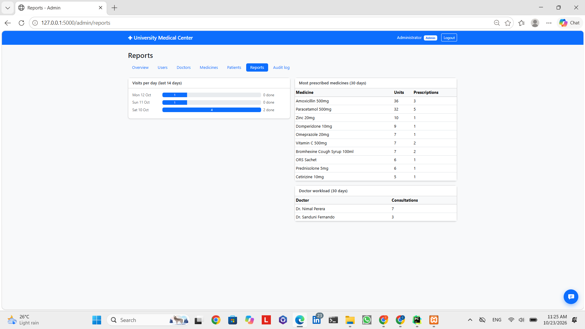 |

### AI Assistant
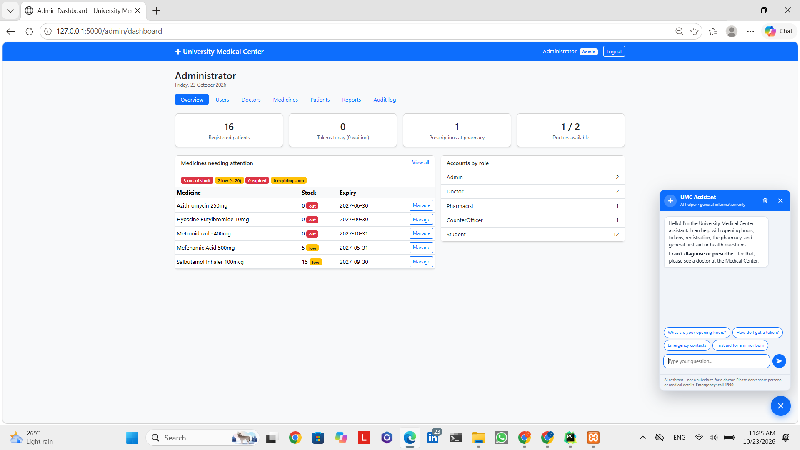

---

## 🧱 Tech Stack

- **Backend:** Python, Flask (Blueprints per module)
- **Database:** MySQL / MariaDB (XAMPP), stored procedure, views, transactions
- **Frontend:** Jinja2 templates, Bootstrap 5, vanilla JavaScript
- **AI:** Google Gemini API (`google-genai`)

## 🗂️ Project Structure

```
university_medical_center/
├── app.py                  # Flask app factory, blueprints, CSRF
├── config.py               # Settings read from .env
├── create_admin.py         # Creates the first Admin login
├── check_setup.py          # Verifies the project is set up correctly
├── database/
│   ├── schema.sql          # Tables, views, stored procedure (fresh install)
│   ├── seed_data.sql       # Demo data
│   └── migration_admin.sql # Adds Admin role to an existing database
├── modules/
│   ├── auth/  patients/  counter/  doctor/  pharmacy/
│   ├── admin/              # Admin dashboard, users, stock, reports, audit
│   └── chatbot/            # Gemini assistant + knowledge base
├── templates/              # HTML pages
├── static/                 # CSS and JavaScript
└── docs/screenshots/       # README images
```

---

## 🚀 Getting Started

### 1. Requirements
- Python 3.10+
- XAMPP (MySQL / MariaDB) running

### 2. Clone and install
```bash
git clone https://github.com/CharukaThennakoon/university-medical-center.git
cd university-medical-center

python -m venv .venv
.venv\Scripts\activate          # Windows
pip install -r requirements.txt
```

### 3. Set up the database
1. Start **MySQL** in the XAMPP control panel.
2. Open **phpMyAdmin → Import** and import `database/schema.sql`, then `database/seed_data.sql`.

> ⚠️ `schema.sql` begins with `DROP DATABASE`. Only use it for a fresh install, never on a database that has real data. For an existing database, import `database/migration_admin.sql` instead.

### 4. Configure environment
```bash
copy .env.example .env          # Windows
```
Open `.env` and set a long random `SECRET_KEY`. Optionally add a free `GEMINI_API_KEY` from [Google AI Studio](https://aistudio.google.com/apikey) to enable the chatbot.

### 5. Create an admin and run
```bash
python create_admin.py
python app.py
```
Open **http://127.0.0.1:5000**

---

## 🔑 Demo Accounts

Created by `seed_data.sql`. Password for all: `Password@123`

| Role | Username |
|------|----------|
| Student | `AR1001` |
| Doctor | `doctor1`, `doctor2` |
| Pharmacist | `pharmacist1` |
| Counter Officer | `counter1` |
| Admin | `admin1` |

> 🔒 These are for **demo only**. Change all passwords and set `FLASK_DEBUG=0` before any real use.

---

## 🛣️ Roadmap
- [ ] Forgot-password flow for students
- [ ] Cancel / no-show token status
- [ ] Prescription cancellation and stock return
- [ ] Login rate limiting
- [ ] Automated tests

## 👤 Author

**Charuka Thennakoon**
GitHub: [@CharukaThennakoon](https://github.com/CharukaThennakoon)

## 📄 License

This project is for educational purposes.
